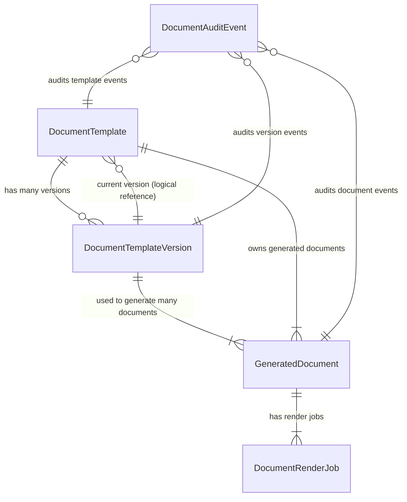

# Document Engine — Data Model and Backend APIs

This document describes Phase 2 of the SpareLab Configurable Document Builder: the generic document engine, its data model, and the initial REST APIs.

The engine is intentionally **generic** — it is not hardcoded for invoices. It supports tax invoices, proforma invoices, quotations, purchase orders, delivery challans, and any other configurable business document type.

## 1. Domain model

The document engine is built around five core entities:

| Entity | Purpose |
|---|---|
| `DocumentTemplate` | A reusable document template (metadata + lifecycle). |
| `DocumentTemplateVersion` | An immutable, versioned snapshot of a template's layout configuration. |
| `GeneratedDocument` | An actual document generated from a specific published template version. |
| `DocumentRenderJob` | A rendering operation (prepared for future async/Kafka rendering). |
| `DocumentAuditEvent` | An append-only record of important document/template operations. |

## 2. Entity relationships



- A `DocumentTemplate` has many `DocumentTemplateVersion`s. `versionNumber` is unique per `(templateId, versionNumber)`.
- `currentVersionId` on `DocumentTemplate` is a logical reference to the latest published version (kept as a plain column to avoid a cyclic foreign key between template and version).
- A `GeneratedDocument` stores an immutable reference to the exact `DocumentTemplateVersion` used (`templateVersionId`), plus a denormalized `templateId`.
- `GeneratedDocument.templateVersionId` uses `ON DELETE RESTRICT`, so a version referenced by any generated document cannot be deleted.
- `DocumentRenderJob.documentId` uses `ON DELETE CASCADE`.

## 3. Prisma model overview

The Prisma schema lives in `apps/api/prisma/schema.prisma`. Enums: `TemplateStatus` (DRAFT/PUBLISHED/ARCHIVED), `VersionStatus` (DRAFT/PUBLISHED), `DocumentStatus` (DRAFT/GENERATED/FAILED), `RenderJobStatus` (PENDING/IN_PROGRESS/COMPLETED/FAILED).

Key fields:

**DocumentTemplate**
- `id` (UUID, PK), `name`, `description?`, `documentType`, `status` (default DRAFT), `currentVersionId?`, `createdBy?`, `createdAt`, `updatedAt`
- Indexes: `documentType`, `status`, `createdAt`
- Relation: `versions` → `DocumentTemplateVersion` (via `templateId`)

**DocumentTemplateVersion**
- `id` (UUID, PK), `templateId`, `versionNumber`, `schemaVersion`, `configuration` (JSONB), `status` (default DRAFT), `createdBy?`, `createdAt`
- Indexes: `templateId`; Unique: `(templateId, versionNumber)`
- Relation: `template` → `DocumentTemplate`

**GeneratedDocument**
- `id` (UUID, PK), `templateId`, `templateVersionId`, `documentType`, `documentNumber?`, `externalReferenceId?`, `data` (JSONB), `status` (default GENERATED), `createdAt`, `updatedAt`
- Indexes: `templateId`, `templateVersionId`, `documentType`, `status`, `createdAt`
- `templateVersion` → `DocumentTemplateVersion` (`ON DELETE RESTRICT`)
- `template` → `DocumentTemplate`

**DocumentRenderJob**
- `id` (UUID, PK), `documentId`, `status` (default PENDING), `errorMessage?`, `startedAt?`, `completedAt?`, `createdAt`
- `document` → `GeneratedDocument` (`ON DELETE CASCADE`)

**DocumentAuditEvent**
- `id` (UUID, PK), `entityType`, `entityId`, `action`, `actorId?`, `metadata?` (JSONB), `createdAt`
- Indexes: `(entityType, entityId)`, `action`, `createdAt`

## 4. Template JSON schema

The template configuration is a versioned JSON document stored in `DocumentTemplateVersion.configuration` (JSONB). It is validated with Zod in the shared contracts package (`@sparelab/contracts`, `packages/contracts/src/schemas/template-config.ts`).

Design principles:
- No executable JavaScript and no arbitrary user-supplied HTML.
- Structured, validated blocks only.
- `schemaVersion` field for future migrations.
- Template configuration is kept separate from generated document data.

Supported block types (this phase): `text`, `image`, `table`.

```json
{
  "schemaVersion": "1.0.0",
  "page": {
    "size": "A4",
    "orientation": "portrait",
    "margins": { "top": 20, "right": 20, "bottom": 20, "left": 20 }
  },
  "sections": [
    {
      "id": "s1",
      "name": "Header",
      "visible": true,
      "blocks": [
        { "id": "b1", "type": "text", "content": "Tax Invoice", "binding": "{{title}}", "visible": true },
        { "id": "b2", "type": "image", "src": "https://cdn.example.com/logo.png", "alt": "Logo", "width": 120 },
        {
          "id": "b3",
          "type": "table",
          "columns": [
            { "id": "c1", "header": "Item", "key": "item" },
            { "id": "c2", "header": "Amount", "key": "amount" }
          ],
          "rows": [["{{item1}}", "{{amount1}}"], ["{{item2}}", "{{amount2}}"]]
        }
      ]
    }
  ],
  "header": { "blocks": [ { "id": "h1", "type": "text", "content": "Company Name" } ] },
  "footer": { "blocks": [ { "id": "f1", "type": "text", "content": "Page {{page}}", "binding": "{{page}}" } ] }
}
```

- `src` on image blocks must be an `https://`/`http://` URL or a `{{binding}}` reference — arbitrary HTML/JS is rejected.
- Bindings use the `{{fieldName}}` format and reference generated document data.
- The schema exposes `validateTemplateConfiguration(value)` which throws a `ZodError` on invalid input; the backend converts this to a `400 BadRequest`.

## 5. Document data versus template configuration

| | Template configuration | Generated document data |
|---|---|---|
| Stored in | `DocumentTemplateVersion.configuration` | `GeneratedDocument.data` |
| Purpose | Layout, styling, block definitions | Runtime values bound into the layout |
| Versioned | Yes (per template version) | No (snapshot per generated document) |
| Validated with | `TemplateConfigurationSchema` (Zod) | `DocumentDataSchema` (must be a JSON object) |
| Mutable after publish | No (versions are immutable) | No (snapshot) |

The two are deliberately separate: a change to a template's layout must never alter the data of already-generated documents.

## 6. Versioning and publishing lifecycle

1. `POST /api/templates` creates a template in `DRAFT` status with an initial version (`versionNumber: 1`, status `DRAFT`).
2. `POST /api/templates/:id/versions` creates a new draft version. `versionNumber` auto-increments per template.
3. Only a **draft** version's configuration can be authored/changed. Published versions are immutable.
4. `POST /api/templates/:id/publish` publishes the template's current version:
   - Validates the configuration.
   - Sets the version status to `PUBLISHED`.
   - Sets `template.status = PUBLISHED` and `template.currentVersionId` to the version.
   - Publishing an already-published version returns `409 Conflict`.
5. `POST /api/documents` requires a `templateVersionId` that references a **published** version. Draft or unknown versions are rejected (`400` / `404`).

## 7. API endpoint documentation

All endpoints are mounted under the global prefix `/api` (configurable via `API_PREFIX`, default `/api`). Responses use a consistent envelope: single items return `{ data }`, lists return `{ data, meta: { page, limit, total } }`.

### Templates

| Method | Endpoint | Description | Success |
|---|---|---|---|
| `POST` | `/api/templates` | Create a template and its initial draft version | `201` |
| `GET` | `/api/templates` | List templates with pagination (`page`, `limit`) | `200` |
| `GET` | `/api/templates/:id` | Get template metadata and current version | `200` |
| `PATCH` | `/api/templates/:id` | Update template metadata only | `200` |
| `POST` | `/api/templates/:id/versions` | Create a new draft version | `201` |
| `GET` | `/api/templates/:id/versions` | List template versions | `200` |
| `GET` | `/api/templates/:id/versions/:versionId` | Get a specific version | `200` |
| `POST` | `/api/templates/:id/publish` | Publish the current draft version | `200` |

### Documents

| Method | Endpoint | Description | Success |
|---|---|---|---|
| `POST` | `/api/documents` | Create a document from a published template version | `201` |
| `GET` | `/api/documents` | List generated documents with pagination | `200` |
| `GET` | `/api/documents/:id` | Get document details and template version reference | `200` |

Error handling: `404 NotFound` for missing resources; `400 BadRequest` for invalid input / invalid lifecycle transitions; `409 Conflict` for attempting to publish an already-published version.

## 8. Important architectural decisions

- **Generic, not invoice-hardcoded**: `documentType` is a free-form string (validated at the application layer) so the engine serves invoices, quotations, purchase orders, delivery challans, and future types without schema changes.
- **No `currentVersionId` foreign key**: kept as a plain logical-reference column to avoid a cyclic `template ↔ version` foreign key. Referential integrity that matters (`GeneratedDocument → templateVersionId`) is enforced with `ON DELETE RESTRICT`.
- **Immutable published versions**: publishing flips a version to `PUBLISHED`; there is no update-version endpoint, and the service never mutates a published version's configuration.
- **Validation in the backend, not trusted from the frontend**: template configuration is validated with Zod at service layer (`validateTemplateConfiguration`); document data is validated as a JSON object. class-validator DTOs provide the first line of defense at the controller boundary.
- **Database transactions**: multi-write operations (template + initial version; publish template + version) run in a Prisma `$transaction`.
- **Prepared for later phases**: `DocumentRenderJob` models the future async rendering flow (Kafka), but no Kafka, Puppeteer, S3, or PDF generation is implemented in this phase. No authentication, RBAC, GST calculations, or invoice numbering either.
- **Shared contracts**: Zod schemas live in `@sparelab/contracts` and are consumed by the backend for server-side validation (and are available to the frontend in later phases).

## 9. Running the engine

Prisma (from the repository root):

```bash
pnpm --filter @sparelab/api prisma:generate   # generate the Prisma client
pnpm --filter @sparelab/api prisma:migrate    # create/apply migrations
```

Build and test:

```bash
pnpm build:api                                # TypeScript build
pnpm lint                                     # ESLint
pnpm test                                     # Jest (runs serially --runInBand)
```

Environment: `apps/api/.env` provides `DATABASE_URL` (PostgreSQL 16 on port 5433 via docker-compose), `PORT` (default 3001), and `API_PREFIX` (default `/api`).
